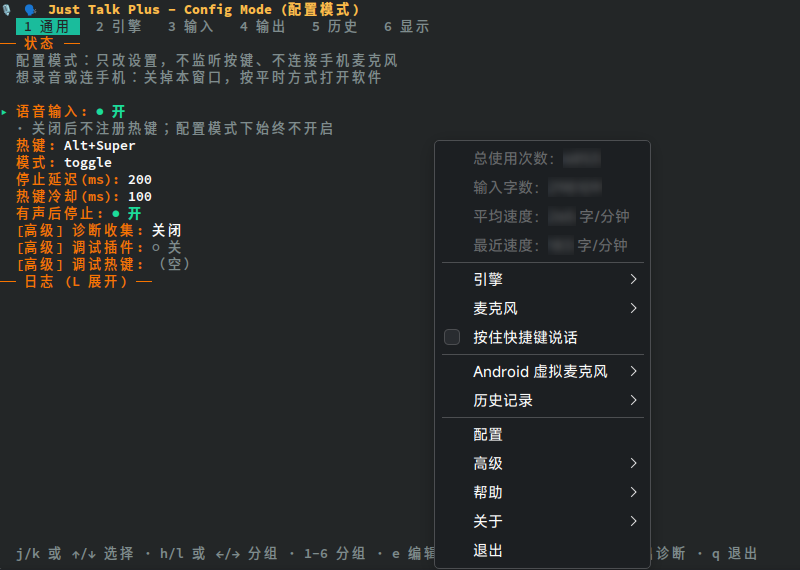

# Just Talk Plus

[中文](README.md)

Just Talk Plus is a desktop voice input tool. It records audio with a global hotkey, sends it to streaming ASR, and then copies the recognized text to the clipboard or submits it directly into the focused input field.

It is built for people who want to type less and speak more while coding, chatting, writing notes, or working with long text.

## Screenshot



## Features

- Global hotkey recording with `toggle` and `hold` modes.
- Voice hotkeys are limited to keys suitable for global shortcuts: modifiers, function keys, Tab, CapsLock, arrow/navigation keys, and similar non-text keys. Letters, digits, punctuation, Space, and other text-producing keys are rejected.
- Multiple ASR engines: Doubao (Volcano Engine) streaming ASR (default, live partial results), Qianwen DashScope Fun-ASR realtime streaming (8k models auto-downsampled), AuralWise batch transcription, and OpenAI-compatible Whisper endpoints (official API, Groq, local whisper servers, etc.).
- Microphone debug panel: trigger a test recording with the same hotkey (no ASR), showing live peak/RMS level and clipping, fine-grained gain adjustment (`+`/`-`), and an adaptive-gain toggle (auto-lowers on clipping, slowly recovers when quiet).
- Recognition history panel: the last 10 submitted/copied results are kept in memory and can be re-copied to the clipboard.
- Trailing-punctuation omission: processed uniformly before output — the master toggle strips a trailing Chinese period "。", with sub-options to strip all trailing punctuation or additionally strip ASCII `.` `!` `?`.
- Clipboard copy and automatic text submission.
- Always-on-top recording status overlay for Wayland, X11, macOS, and Windows.
- Component-library TUI (list/help, etc.) organized into tab groups (General / Engine / Microphone / Output / History), so more settings never stretch the screen height.
- ASR hotwords (Doubao) for project names, people names, English terms, and domain-specific vocabulary.
- Usage statistics for total sessions, total recognized characters, average speed, and recent speed.

## Platform Status

Linux, macOS, and Windows desktops are supported:

| Platform | Status | Notes |
| --- | --- | --- |
| Linux Wayland | Supported | Works with Sway / wlroots; hotkeys use evdev and require input permissions |
| Linux X11 | Supported | Uses native X11 global hotkeys |
| macOS | Supported | Global hotkeys use CGEventTap, recording uses CoreAudio, clipboard uses NSPasteboard, and overlay uses AppKit NSPanel |
| Windows 10/11 | Supported | Global key polling with a low-level keyboard-hook edge fallback, WinMM recording, Unicode clipboard, SendInput auto-submit, and a Win32 status overlay |

## Build

Just Talk Plus uses native platform APIs. Linux and macOS builds require cgo; Windows uses direct Win32 calls from Go and does not require cgo.

Linux build dependencies:

```bash
# Arch Linux
sudo pacman -S --needed go gcc libx11 libxtst libxext wayland

# Debian / Ubuntu
sudo apt install golang-go build-essential libx11-dev libxtst-dev libxext-dev libxinerama-dev libwayland-dev
```

macOS build dependencies:

```bash
# Apple Command Line Tools provide clang and the macOS SDK. Full Xcode is not required.
xcode-select --install
```

Windows build dependency:

```powershell
# Install Go 1.25 or later. No ffmpeg, SoX, or C compiler is required.
winget install --id GoLang.Go --exact
```

Build for the current platform:

```bash
cd just-talk-go
CGO_ENABLED=1 go build -o build/just-talk ./cmd/just-talk
```

Windows PowerShell:

```powershell
cd just-talk-go
go build -o build\just-talk.exe .\cmd\just-talk
```

Install to `~/.local/bin/just-talk`:

```bash
# Make sure ~/.local/bin is in PATH. If not, add this line to ~/.bashrc or ~/.zshrc.
# export PATH="$HOME/.local/bin:$PATH"
build/just-talk --install
# or
make install
```

macOS must be built on macOS. The project does not provide a non-cgo build.

Install on Windows to `%LOCALAPPDATA%\Programs\Just Talk Plus\just-talk.exe`:

```powershell
.\build\just-talk.exe --install
# If the directory is not already in PATH, follow the note printed by the command.
```

## Release Downloads

GitHub Releases provide prebuilt archives for:

- Linux amd64 / arm64
- macOS Intel / Apple Silicon
- Windows amd64 / arm64
- `SHA256SUMS.txt` checksum verification

The release workflow uses GoReleaser v2 with the official `goreleaser/goreleaser-action`. Linux, macOS, and Windows binaries are built natively on matching GitHub-hosted runners. Maintainers can build and publish a release by pushing a `v*` tag, for example:

```bash
git tag v0.7.0
git push origin v0.7.0
```

## Usage

Start the TUI:

```bash
just-talk
```

Run without the TUI:

```bash
just-talk --no-tui
```

Force a backend:

```bash
just-talk --backend wayland
just-talk --backend x11
```

Windows selects its native backend automatically. Check the microphone and configuration before first use:

```powershell
.\build\just-talk.exe --doctor
```

## Configuration

Default config path:

```text
# Linux / macOS
~/.config/just-talk/config.toml

# Windows
%APPDATA%\just-talk\config.toml
```

Recommended hotkey config:

```toml
[voice]
mode = "toggle"
push_to_talk = "Alt+Super"
gain = 1
auto_gain = true   # adaptive gain: lower on clipping, recover slowly when quiet
omit_trailing_punct = false  # strip trailing "。" before output (master toggle)
# omit_trailing_all = false  # sub: strip all trailing punctuation (incl. ASCII)
# omit_trailing_ascii = false  # sub: additionally strip ASCII . ! ?
```

`Alt+Super` with `toggle` mode is recommended. Press once to start recording, then press again to stop. This avoids hold-mode key conflicts with desktop environments or focused input fields. On Windows, the low-level keyboard hook only observes key edges and never consumes or replays modifiers, so standalone `Alt`, `Super`, and shortcuts such as `Alt+Tab` retain their normal system behavior. Modifier combinations require the exact configured set, and hook fallback state is checked against the unsuppressed physical key state so separate single-key presses cannot be combined into the shortcut.

Voice hotkeys only support keys suitable for global shortcuts:

- Supported: modifier-only combinations, such as `Alt+Super` and `Ctrl+Alt+Shift`.
- Supported: function keys `F1` through `F24`, such as `F9` and `Alt+F8`.
- Supported: non-text control and navigation keys, such as `Tab`, `Enter`, `Escape`, `Backspace`, `CapsLock`, `Up`, `Down`, `Left`, `Right`, `Home`, `End`, `PageUp`, `PageDown`, `Insert`, and `Delete`.
- Not supported: letters, digits, punctuation, Space, numpad digits, and numpad symbols that can enter text, such as `Alt+G`, `G`, `Alt+1`, and `Alt+Space`.

Hotword example:

```toml
[voice]
hotwords = ["Wayland", "Sway", "wl-copy", "wtype", "just-talk-go"]
```

macOS hotkey example:

```toml
[voice]
# Option is Alt; Command/Cmd is Super.
push_to_talk = "Option+Command"
```

On Windows, `Win` and `Super` both refer to the Windows logo key. If recording is unavailable, allow desktop applications to access the microphone under Windows Settings > Privacy & security > Microphone.

### Speech Engines

The `engine` key under `[voice]` selects the ASR engine, and each engine keeps its own private settings under `[voice.engine_configs.<engine>]` (e.g. `[voice.engine_configs.openai]`), so you can store credentials for several channels at once without them overwriting each other. The default is `engine = "doubao-stream"`. In the TUI, pressing Enter on the Engine field opens a channel picker overlay where each channel shows its description; the "engine config" overlay (Enter to open, `s` to save, `esc` to cancel) edits the current engine's credentials and settings and persists them into `engine_configs.<engine>`; the "related links" overlay lists documentation links for all engines and opens one in the browser with Enter. The legacy flat `engine_config` and `app_key` / `access_key` / `resource_id` fields remain as compatibility shortcuts for migration reads.

#### Doubao (Volcano Engine) Streaming ASR

Live partial results and hotword support. Doubao has two access modes:

| Access | model_version | Credentials | Default resource ID |
| --- | --- | --- | --- |
| Doubao 1.0 (legacy console) | `1.0` | `app_id` + `access_key` (or legacy flat `app_key` / `access_key`) | `volc.bigasr.sauc.*` |
| Doubao 2.0 (new console) | `2.0` | `api_key` | `volc.seedasr.sauc.*` |

Credentials: use `api_key` with the `X-Api-Key` from the new console, or `app_id` + `access_key` with legacy console credentials. Example:

```toml
[voice]
engine = "doubao-stream"
language = "zh-CN"

[voice.engine_configs.doubao-stream]
# New console credentials
api_key = "…"
# Or legacy credentials:
# app_id = "…"
# access_key = "…"
# Access mode:
model_version = "1.0"      # 1.0=bigasr (default) | 2.0=seedasr
stream_mode = "async"      # nostream | async (default async; bidirectional + second-pass)
# resource_id = "volc.bigasr.sauc.duration"  # explicit resource override
# base_host = "openspeech.bytedance.com"
```

AuralWise async task transcription (whole-recording recognition, no public URL required):

```toml
[voice]
engine = "auralwise"

[voice.engine_configs.auralwise]
api_key = "asr_…"
# base_url = "https://api.auralwise.cn/v1"
# optimize = "auto"          # auto | true | false
# poll_timeout = "10m"
```

OpenAI-compatible Whisper endpoint (official API, Groq, local whisper server, etc.). To explore available transcription models, see the [QianwenAI model catalog (search asr)](https://www.qianwenai.com/models?search=asr):

```toml
[voice]
engine = "openai"

[voice.engine_configs.openai]
api_key = "sk-…"
# base_url = "https://api.openai.com/v1"   # point at any compatible endpoint
# model = "whisper-1"
```

Qianwen (DashScope) Fun-ASR realtime streaming recognition (WebSocket, live partial results). Docs: [Realtime ASR](https://platform.qianwenai.com/docs/developer-guides/speech/asr-realtime):

```toml
[voice]
engine = "dashscope"

[voice.engine_configs.dashscope]
api_key = "sk-…"        # DASHSCOPE_API_KEY
# model = "fun-asr-realtime"            # 8k models (e.g. fun-asr-flash-8k-realtime) downsample to 8000 Hz automatically
# sample_rate = "16000"                 # 8000 | 16000
# base_url = "wss://dashscope.aliyuncs.com/api-ws/v1/inference/"
# language = "zh-CN"
```

Batch engines (auralwise / openai) transcribe the whole recording after you stop and need a longer wait; streaming engines (doubao-stream / dashscope) show partial results while recording. Set `engine = "null"` to disable recognition.

### Microphone Debug And Recognition History

Select "麦克风调试" in the TUI main form and press Enter to open the debug panel:

- Press the **same recording hotkey** to start/stop a test recording (microphone only; no ASR, no submit)
- Live peak/RMS level bars and clipping warning
- `+` / `-` fine-grained gain adjustment (1-100, applied live and persisted)
- Space toggles adaptive gain (lower on clipping, recover slowly when quiet)

The "历史记录" panel shows the last 10 successfully submitted/copied results; `j`/`k` to select, Enter to re-copy to the clipboard, `esc` to exit.


## Changelog

See [CHANGELOG.md](CHANGELOG.md).

## Maintenance And Contributions

Just Talk Plus is maintained by `conglinyizhi` (continuing the original work by `whoamihappyhacking`; see [NOTICE](NOTICE) for copyright statements).

This project does not accept pull requests. Issues are welcome for bug reports, usage feedback, and feature discussion.

## License

Just Talk Plus is licensed under the GNU General Public License v3.0.
