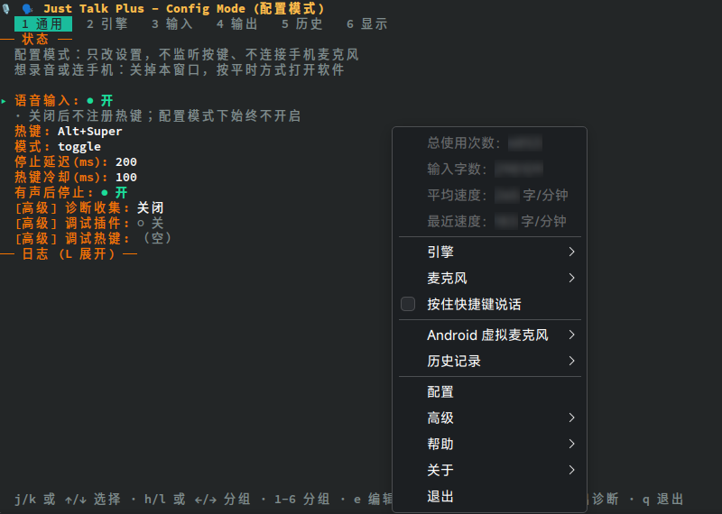

# Just Talk Plus

[English](README.en.md)

减少用键盘的次数，改用口喷吧。

Just Talk Plus 是一个面向桌面环境的语音输入工具。它通过全局快捷键录音，把语音识别结果复制到剪贴板，或直接上屏到当前输入框，适合写代码、聊天、记笔记和处理长文本输入。

## 截图



## 功能

- 全局快捷键录音，支持 `toggle` 和 `hold` 两种模式。
- 语音热键限定为适合作为全局快捷键的按键：支持纯修饰键、功能键、Tab、CapsLock、方向键和导航键等；不支持字母、数字、标点、空格等普通字符键。
- 多语音引擎可选：豆包（火山引擎）流式 ASR（默认，边录边识别）、千问 DashScope Fun-ASR 实时流式（8k 模型自动降采样）、AuralWise 批处理转写、OpenAI 兼容 Whisper 接口（可指向本地 whisper / Groq 等端点）。
- 麦克风调试面板：同一录音热键触发测试录音（不进识别），实时显示峰值/有效电平与削波，细粒度调整增益（`+`/`-`），并可切换自适应增益（爆音自动降低、安静后缓慢恢复）。
- 识别历史面板：最近 10 条上屏/复制结果保存在内存，可选中重新复制到剪贴板。
- 句尾标点省略：输出前统一处理，主开关省略句尾句号「。」，可扩展为切断句尾所有符号或额外省略英文 `.` `!` `?`。
- 自动复制到剪贴板，支持自动上屏。
- Wayland / X11 / macOS / Windows 顶层录音状态胶囊提示。
- TUI 配置界面基于组件库（list/help 等）并采用 tab 分组（通用/引擎/麦克风/输出/历史），设置项再多也不撑高界面。
- 热词增强识别（豆包），适合项目名、人名、英文术语和专有名词。
- 录音历史统计，包括历史次数、总字数、平均速度和最近速度。

## 平台状态

当前支持 Linux、macOS 和 Windows 桌面：

| 平台 | 状态 | 说明 |
| --- | --- | --- |
| Linux Wayland | 已支持 | 已支持 Sway / wlroots 场景；快捷键基于 evdev，需要 input 权限 |
| Linux X11 | 已支持 | 使用 X11 原生全局热键 |
| macOS | 已支持 | 全局快捷键基于 CGEventTap，录音使用 CoreAudio，剪贴板使用 NSPasteboard，胶囊显示使用 AppKit NSPanel |
| Windows 10/11 | 已支持 | 全局按键轮询及低级键盘钩子边沿回退、WinMM 录音、Unicode 剪贴板、SendInput 自动上屏和 Win32 状态胶囊 |

## 构建

Just Talk Plus 依赖平台原生能力。Linux 和 macOS 构建需要启用 cgo；Windows 使用纯 Go 的 Win32 调用，不需要 cgo。

Linux 构建依赖：

```bash
# Arch Linux
sudo pacman -S --needed go gcc libx11 libxtst libxext wayland

# Debian / Ubuntu
sudo apt install golang-go build-essential libx11-dev libxtst-dev libxext-dev libxinerama-dev libwayland-dev
```

macOS 构建依赖：

```bash
# 需要 Apple Command Line Tools 提供 clang 和 macOS SDK；不需要安装完整 Xcode。
xcode-select --install
```

Windows 构建依赖：

```powershell
# 安装 Go 1.25 或更高版本；不需要额外安装 ffmpeg、SoX 或 C 编译器。
winget install --id GoLang.Go --exact
```

构建当前平台二进制：

```bash
cd just-talk-go
CGO_ENABLED=1 go build -o build/just-talk ./cmd/just-talk
```

Windows PowerShell：

```powershell
cd just-talk-go
go build -o build\just-talk.exe .\cmd\just-talk
```

安装到 `~/.local/bin/just-talk`：

```bash
# 确保 ~/.local/bin 在 PATH 中（如未配置，将下面这行加入 ~/.bashrc 或 ~/.zshrc）
# export PATH="$HOME/.local/bin:$PATH"
build/just-talk --install
# 或
make install
```

macOS 需要在本机 macOS 上构建；项目不提供非 cgo 版本。

Windows 安装到 `%LOCALAPPDATA%\Programs\Just Talk Plus\just-talk.exe`：

```powershell
.\build\just-talk.exe --install
# 如果安装目录尚未在 PATH 中，按命令输出提示添加即可。
```

## Release 下载

GitHub Release 提供以下预编译归档：

- Linux amd64 / arm64
- macOS Intel / Apple Silicon
- Windows amd64 / arm64
- `SHA256SUMS.txt` 文件校验

发布流程使用 GoReleaser v2 和官方 `goreleaser/goreleaser-action`。Linux、macOS 和 Windows 二进制分别在对应的 GitHub 托管 runner 上原生构建；维护者推送 `v*` 标签时会自动构建并发布，例如：

```bash
git tag v0.7.0
git push origin v0.7.0
```

## 使用

默认启动 TUI：

```bash
just-talk
```

后台模式：

```bash
just-talk --no-tui
```

指定后端：

```bash
just-talk --backend wayland
just-talk --backend x11
```

Windows 不需要指定后端。首次使用前可检查麦克风和配置：

```powershell
.\build\just-talk.exe --doctor
```

## 配置

默认配置路径：

```text
# Linux / macOS
~/.config/just-talk/config.toml

# Windows
%APPDATA%\just-talk\config.toml
```

推荐热键配置：

```toml
[voice]
mode = "toggle"
push_to_talk = "Alt+Super"
gain = 1
auto_gain = true   # 自适应增益：爆音自动降低，安静后缓慢恢复（可细粒度微调）
omit_trailing_punct = false  # 输出前省略句尾句号「。」（主设置）
# omit_trailing_all = false  # 副设置：切断句尾所有符号（含英文）
# omit_trailing_ascii = false  # 副设置：额外省略英文 . ! ?
```

`Alt+Super` 配合 `toggle` 模式是推荐用法。按一次开始录音，再按一次停止录音，避免按住模式下和桌面环境或输入框发生按键冲突。在 Windows 上，低级键盘钩子只观察按键边沿，不会消费或回放修饰键，因此单独使用 `Alt`、`Super` 或 `Alt+Tab` 时会保持系统原有行为。组合键必须精确匹配配置的修饰键集合；钩子回退状态会通过未拦截的物理按键状态校验，避免把两次独立的单键按下拼成组合键。

语音热键只支持适合作为全局快捷键的按键：

- 支持：纯修饰键组合，如 `Alt+Super`、`Ctrl+Alt+Shift`。
- 支持：功能键 `F1` 到 `F24`，如 `F9`、`Alt+F8`。
- 支持：非文本控制键和导航键，如 `Tab`、`Enter`、`Escape`、`Backspace`、`CapsLock`、`Up`、`Down`、`Left`、`Right`、`Home`、`End`、`PageUp`、`PageDown`、`Insert`、`Delete`。
- 不支持：字母、数字、标点、空格、数字小键盘数字和符号等会输入文本的按键，如 `Alt+G`、`G`、`Alt+1`、`Alt+Space`。

热词示例：

```toml
[voice]
hotwords = ["Wayland", "Sway", "wl-copy", "wtype", "just-talk-go"]
```

macOS 热键写法：

```toml
[voice]
# Option 等价于 Alt，Command/Cmd 等价于 Super
push_to_talk = "Option+Command"
```

Windows 使用 `Win` 或 `Super` 表示 Windows 徽标键。如果麦克风不可用，请在“Windows 设置 → 隐私和安全性 → 麦克风”中允许桌面应用访问麦克风。

### 语音引擎

`[voice]` 下的 `engine` 选择识别引擎，每个引擎的私有配置单独存放于 `[voice.engine_configs.<engine>]`（如 `[voice.engine_configs.openai]`），可同时保存多个渠道的凭据、互不覆盖。默认 `engine = "doubao-stream"`。TUI 中「引擎」字段按回车会打开渠道选择弹层，每个渠道附特点说明；「引擎配置」二级弹层（按回车进入、`s` 保存、`esc` 取消）编辑当前引擎的凭据与专属设置，保存后写入 `engine_configs.<engine>`；「相关链接」弹层汇总全部引擎的文档链接，回车用浏览器打开。旧版平铺 `engine_config` 与 `app_key` / `access_key` / `resource_id` 字段仍作为迁移读取的兼容写法保留。

#### 豆包（火山引擎）流式 ASR

边录边识别，支持热词。豆包有两种接入方式：

| 接入方式 | 模型版本 | 凭据 | 资源 ID（默认） |
| --- | --- | --- | --- |
| 豆包 1.0（旧版控制台） | `1.0` | `app_id` + `access_key`（或旧版平铺 `app_key` / `access_key`） | `volc.bigasr.sauc.*` |
| 豆包 2.0（新版控制台） | `2.0` | `api_key` | `volc.seedasr.sauc.*` |

新版凭据二选一：新版控制台创建应用后拿到 `X-Api-Key`，用 `api_key`；旧版控制台的 App ID + Access Token 用 `app_id` + `access_key`。示例：

```toml
[voice]
engine = "doubao-stream"
language = "zh-CN"

[voice.engine_configs.doubao-stream]
# 新版控制台凭据
api_key = "…"
# 或用旧版凭据：
# app_id = "…"
# access_key = "…"
# 接入方式：
model_version = "1.0"      # 1.0=bigasr（默认） | 2.0=seedasr
stream_mode = "async"      # nostream | async（默认 async；双向流+二遍识别）
# resource_id = "volc.bigasr.sauc.duration"  # 显式覆盖资源 ID
# base_host = "openspeech.bytedance.com"
```

AuralWise 异步任务转写（整段录音识别，无需公网 URL）：

```toml
[voice]
engine = "auralwise"

[voice.engine_configs.auralwise]
api_key = "asr_…"
# base_url = "https://api.auralwise.cn/v1"
# optimize = "auto"          # auto | true | false
# poll_timeout = "10m"
```

OpenAI 兼容 Whisper 接口（官方 API、Groq、本地 whisper 服务等）。想了解可用的转写模型，可以访问 [QianwenAI 模型库（搜索 asr）](https://www.qianwenai.com/models?search=asr) 参考：

```toml
[voice]
engine = "openai"

[voice.engine_configs.openai]
api_key = "sk-…"
# base_url = "https://api.openai.com/v1"   # 可指向兼容端点
# model = "whisper-1"
```

千问（DashScope）Fun-ASR 实时流式识别（WebSocket，边录边出字）。文档见 [实时语音识别](https://platform.qianwenai.com/docs/developer-guides/speech/asr-realtime)：

```toml
[voice]
engine = "dashscope"

[voice.engine_configs.dashscope]
api_key = "sk-…"        # DASHSCOPE_API_KEY
# model = "fun-asr-realtime"            # 8k 模型（如 fun-asr-flash-8k-realtime）自动降采样到 8000 Hz
# sample_rate = "16000"                 # 8000 | 16000
# base_url = "wss://dashscope.aliyuncs.com/api-ws/v1/inference/"
# language = "zh-CN"
```

批处理引擎（auralwise / openai）在录音结束后一次性转写，需要更长的等待时间；流式引擎（doubao-stream / dashscope）在识别过程中即可看到部分结果。`engine = "null"` 用于禁用识别。

### 麦克风调试与识别历史

TUI 主界面选择「麦克风调试」回车进入调试面板：

- 按**同一录音热键**触发/停止测试录音（只测麦克风，不触发识别与上屏）
- 实时显示峰值/有效电平条与削波警告
- `+` / `-` 细粒度调整增益（1–100，实时生效并持久化）
- 空格切换自适应增益（爆音自动降低、安静后缓慢恢复）

「历史记录」面板展示最近 10 条成功上屏/复制的识别结果，`j`/`k` 选择、回车重新复制到剪贴板，`esc` 退出。


## 更新日志

见 [CHANGELOG.md](CHANGELOG.md)。

## 维护与贡献

Just Talk Plus 由 `conglinyizhi` 维护（基于 `whoamihappyhacking` 的原作继续开发，版权声明见 [NOTICE](NOTICE)）。

本项目不接受 Pull Request。欢迎通过 Issue 反馈 bug、使用体验和功能建议。

## 许可证

Just Talk Plus 使用 GNU General Public License v3.0 开源。
